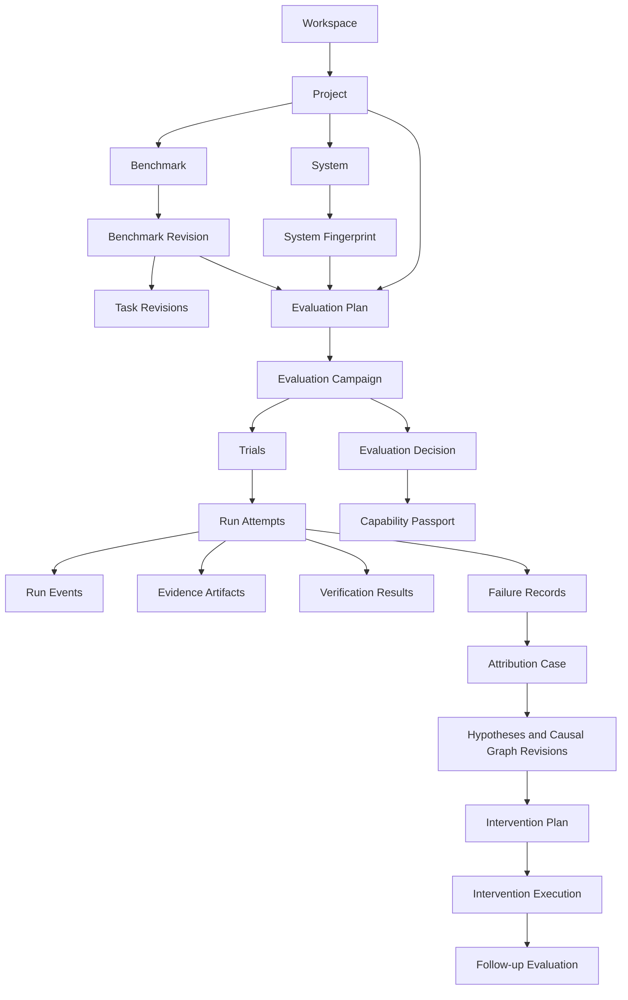

# Workbench Domain Model

**Version:** 0.1 — proposed logical model  
**Status:** review before canonical JSON Schemas or database migrations

## 1. Domain purpose

The Workbench must answer four different questions without collapsing them into one score:

1. What was the system configured to do, and under what conditions?
2. What actually happened during each planned observation?
3. What does independent evidence establish about the outcome and its causes?
4. What decision or intervention is justified by the evidence, within what scope?

Records must preserve the distinction between observed facts, evaluator judgments, causal hypotheses, and decisions. Missing or redacted evidence must remain visible as missing or redacted; it must never be replaced by inferred values.

## 2. Core relationships



A diagram shows logical relationships, not a final relational schema or foreign-key layout.

## 3. Primary records

| Record | Purpose | Mutability rule |
|---|---|---|
| `Workspace` | Ownership and future tenant boundary | Mutable metadata; stable ID |
| `Project` | Groups systems, benchmarks, evaluations, and evidence | Mutable metadata; project-scoped access |
| `System` | Logical identity of the system under test | Mutable descriptive record |
| `SystemFingerprint` | Immutable snapshot of the exact evaluated configuration | Immutable; changed configuration creates a new fingerprint |
| `Benchmark` | Logical identity of a benchmark suite | Mutable descriptive record |
| `BenchmarkRevision` | Frozen benchmark/task-set definition | Immutable once used by an evaluation |
| `TaskRevision` | Versioned task, fixture, acceptance criteria, and verification plan | Immutable once used by an evaluation |
| `EvaluationPlan` | Frozen experiment/evaluation design | Immutable after freeze; revise by creating a new revision |
| `Evaluation` | One execution campaign of a frozen plan | Append-oriented lifecycle and result revisions |
| `Trial` | One planned statistical observation, such as task × condition × replicate | Immutable assignment after execution begins; record deviations explicitly |
| `Run` | One actual agent execution attempt for a trial | Append-oriented; retries create additional run attempts |
| `RunEvent` | Ordered, observable execution event or event summary | Append-only |
| `EvidenceArtifact` | Trace, output, fixture, screenshot, report, or other evidence payload | Content immutable; metadata may be superseded, not silently rewritten |
| `VerificationResult` | Independent check of a criterion against an inspected state | Append-only; re-verification creates another result |
| `Failure` | Evidence-backed violated requirement, invariant, or prohibited outcome | Append-only; corrections create superseding records |
| `AttributionCase` | Investigation connecting failures, hypotheses, and causal graph revisions | Versioned, with explicit lifecycle state |
| `AttributionHypothesis` | Proposed causal explanation with predictions and evidence | Versioned; can be supported, refuted, or unresolved |
| `CausalGraphRevision` | Versioned directed graph of diagnostic and causal relationships | Immutable per revision |
| `InterventionPlan` | Proposed controlled change and validation design | Versioned; approval required when policy says so |
| `InterventionExecution` | Actual intervention, control/treatment runs, results, and side effects | Append-oriented |
| `DecisionRecord` | Explicit readiness or evaluation decision bounded by evidence | Immutable decision; later decision supersedes it |
| `CapabilityPassport` | Bounded evidence summary for a specific configuration/workload scope | Versioned; expiry/review date and invalidation conditions |

A `Project` is the main user-facing organization unit. Every project-owned record must resolve to exactly one project and workspace, directly or through a parent record. Enforce scope on every read and write; never trust a client-supplied `workspace_id` as proof of authorization.

## 4. The Evaluation → Trial → Run distinction

These are not synonyms.

- **Evaluation:** a campaign that executes one frozen evaluation plan. It owns campaign-level status, scheduling, progress, and aggregate results.
- **Trial:** one planned observation in the experimental design. It identifies the task revision, condition, replicate, stratum, ordering/randomization assignment, and sampling-unit identity.
- **Run:** one actual agent execution attempt associated with a trial. It contains the system fingerprint actually used, runner identity, observed events, resource use, and artifact references.

A trial may have multiple run attempts because of infrastructure retries or explicitly authorized replays. Those attempts are not automatically independent samples. The evaluation plan must define which attempt, if any, is eligible for the primary analysis and how retries, timeouts, and invalidated attempts are handled. A deliberate additional replicate is a new `Trial`, not a retry disguised as one.

This distinction is required for valid denominators, repeated-trial statistics, and honest pass@k/pass^k reporting.

## 5. System and fingerprint model

`System` is a stable logical identity, such as “Support Agent” or “Repository Maintenance Agent.” `SystemFingerprint` captures the exact configuration relevant to a claim.

A fingerprint should include, where observable:

- Model provider, model/version, inference parameters, and routing/fallback behavior.
- Agent runtime, harness, planner, orchestrator, and relevant component versions.
- System/developer instructions and prompt assets, with revision or content hash.
- Skill identities, revisions/hashes, discovery/loading configuration, and platform integration settings.
- Tool names, schemas, adapters, versions, permissions, identities, and network-egress rules.
- Memory/retrieval configuration, corpus/index/embedding revisions, and relevant context policies.
- Environment image, OS/runtime, dependencies, fixtures, initial state, resource limits, and network policy.
- Grader, verifier, benchmark, and evaluator versions.
- Budgets, timeout, retry, concurrency, and stopping configuration.
- Unknown, unavailable, or redacted fields with an explicit reason.

Never include secret values. Use secret-manager references or redacted identifiers. A fingerprint is not complete merely because the known fields are populated; it must also disclose unobservable dimensions.

## 6. Benchmark and task model

A `Benchmark` is a named logical suite. A `BenchmarkRevision` freezes the exact tasks, task revisions, environment/fixture assumptions, scoring and validity policy, and hidden-evaluator handling used by an evaluation.

A `TaskRevision` should define:

- Objective and user-visible instruction.
- Initial state and input/fixture references.
- Permitted tools, side effects, and autonomy constraints.
- Preconditions, acceptance criteria, prohibited outcomes, and invariants.
- Independent verification plan and required evidence.
- Task family, difficulty/risk strata, and validity state.
- Hidden grader data separately from agent-visible input.

Validity is a separate state from run outcome. A task discovered to be ambiguous or broken is not a “failed run”; it is an invalid or under-review benchmark item with an auditable reason.

## 7. Evaluation plan and campaign

An `EvaluationPlan` freezes:

- Decision question and intended workload scope.
- System fingerprint(s), benchmark revision, and control/treatment conditions.
- Sampling frame, task selection, strata, planned trial counts, and replicate logic.
- Ordering/randomization, concurrency, and contamination controls.
- Primary/secondary metrics and aggregation rules.
- Grader/verifier versions and independent verification requirements.
- Time, token, cost, tool-call, and resource budgets.
- Timeout/retry policy, exclusion rules, and stopping rules.
- Statistical analysis plan, uncertainty reporting, and predeclared decision gates.
- Required approvals and safety/isolation constraints.

An `Evaluation` is a specific execution of that plan. It must preserve the exact plan revision/hash and any permitted runtime overrides. Overrides are recorded, not silently folded into the original plan.

## 8. Runs, events, and verification

A `Run` records an actual execution. Observable events may include task input delivery, model request metadata where permitted, tool invocation/response, file or state changes, errors, timeout, handoff, human intervention, final output, and cleanup. Each event needs a monotonic per-run sequence or equivalent ordering evidence, timestamps, actor/component identity, correlation/parent identifiers where available, and source/provenance references.

Do not require hidden chain-of-thought. User-visible outputs, tool requests and responses, observable state changes, runtime events, and independent verification are sufficient for evaluation and attribution.

The agent’s claim that it completed a task is not a `VerificationResult`. Verification records identify the criterion, inspected target state, verifier/version, method, evidence, result, and limitations. Verification can be unavailable or inconclusive without forcing a pass/fail.

## 9. Failure and attribution model

A `Failure` links to the run, violated requirement/invariant, decisive event(s), and supporting evidence. Preserve errors, recoveries, final outcome, and prohibited side effects separately.

Keep these gap types distinct:

- `detection_gap`: an intended detector, monitor, or verifier failed to recognize a relevant error or violation.
- `containment_gap`: a detected or otherwise observable issue was not stopped or limited by the expected enforcing control.
- `reporting_gap`: a material action, state, violation, or outcome was omitted, delayed, or inaccurately represented.

They may coexist, but one must not be inferred from another. A failure attribution report therefore maintains independent `detection_gap_refs`, `containment_gap_refs`, and `reporting_gap_refs`.

An `AttributionCase` may cover multiple related failures. It keeps competing hypotheses, support and contradicting evidence, causal graph revisions, confidence basis, alternative explanations, missing telemetry, and next tests. A causal graph must distinguish causal edges from diagnostic, temporal, and correlational relationships. `correlated_with` and `preceded` are never causal proof. A graph revision with causal edges must be acyclic; validate this as a domain invariant, not merely as JSON shape.

A hypothesis may be `confirmed` only when direct mechanistic evidence establishes the mechanism or a suitably controlled and replicated intervention supports the causal claim. A single uncontrolled replay, temporal association, or model-generated explanation is not enough.

## 10. Intervention and decision model

An `InterventionPlan` identifies the hypothesis, exact versioned target asset(s), proposed change, expected mechanism, control and treatment conditions, task set, trial protocol, approval, isolation/rollback plan, success criteria, and side-effect checks.

An `InterventionExecution` records what actually changed, approvals, control/treatment runs, deviations, independent verification, uncertainty, regressions, side effects, and the resulting hypothesis update. If several factors change together, do not attribute the outcome to one factor without additional experiments.

A `DecisionRecord` makes an explicit decision such as `ready`, `conditionally_ready`, `not_ready`, `insufficient_evidence`, or `not_assessed`. It states the exact system fingerprint, workload, benchmark/task families, environment, autonomy level, time window, evidence references, gates, exclusions, and permitted-use constraints. A numeric aggregate is not a decision.

A `CapabilityPassport` packages this bounded decision and its evidence summary. It is not universal certification or a guarantee. Material fingerprint changes may invalidate all or part of its claims.

## 11. Common record envelope

The final contracts should standardize a common envelope with fields along these lines:

```yaml
record_id: "opaque-stable-id"
record_type: "evaluation_run"
schema_id: "https://schemas.cybercoretech.example/evaluation/run.schema.json"
schema_version: "0.1.0"
workspace_id: "workspace-id"
project_id: "project-id"
created_at: "2026-11-16T21:00:00Z"
source:
  system: "local-runner"
  component_version: "0.1.0"
  origin_id: "local-session-id"
provenance:
  parent_records: ["evaluation-id", "trial-id"]
  captured_by: "runner"
  capture_version: "0.1.0"
  integrity:
    algorithm: "sha256"
    digest: "actual-digest-at-runtime"
```

The domain URL above is illustrative and must be replaced with a controlled production schema namespace before publication. Decide ID format, URI namespace, timestamp semantics, and hash encoding in the schema design spike.

## 12. Logical model invariants

1. Every run references exactly one trial and the exact fingerprint used.
2. Every trial belongs to one evaluation and one frozen plan assignment.
3. The plan’s sampling unit and replicate strategy determine the denominator; retry attempts do not silently add samples.
4. Every primary result is traceable to task, benchmark revision, plan, run, verifier, and evidence.
5. Agent-reported status and independently verified result are separate.
6. Run execution status, run outcome, verification state, benchmark validity, attribution state, intervention state, and evaluation decision are separate dimensions.
7. Every material causal edge has supporting evidence, rationale, and an evidence-quality/confidence basis.
8. Observations, interpretations, hypotheses, and decisions are distinct.
9. Redaction, missingness, and unavailable data are explicit.
10. Records used for a published result are immutable or revisioned; corrections never silently rewrite history.
11. Workspace/project authorization is enforced by application services for every data and artifact operation.
12. Schema validation does not substitute for authorization, cross-record invariants, causal checks, or provenance validation.

## 13. Questions to resolve before schema freeze

- Stable ID format and scope (UUIDv7, ULID, or opaque random IDs).
- Whether a trial may contain more than one eligible run and how primary attempt selection works.
- Event storage granularity and query/index strategy at anticipated alpha volume.
- How fingerprints represent unobservable or provider-private configuration.
- Whether benchmark tasks and evaluation plans need reusable nested revisions or content-addressed bundles.
- Passport signature/attestation requirements and revocation model.
- Exact naming of evaluation lifecycle/outcome fields after state-machine review.
