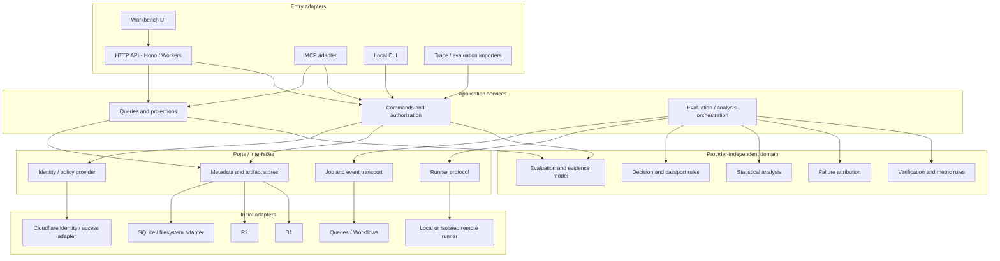

# System Architecture

**Version:** 0.1 — proposed architecture  
**Status:** high-level direction approved; implementation details remain subject to compatibility and security tests

## 1. Architectural objectives

- Provider-independent evaluation and causal-analysis domain.
- First-class local workflow and CLI; no cloud credentials required for local use.
- Cloudflare-hosted private alpha without public self-service registration.
- Versioned, language-neutral data and API contracts.
- Distinct API, MCP, CLI, runner, storage, and provider adapters.
- Evidence integrity, redaction, provenance, and independent verification by design.
- A future multi-workspace model without claiming that the alpha is already production multi-tenant.

## 2. Logical layers

The diagram is logical. It does not mandate one Worker per box or separate deployable services for every layer.

## 3. Proposed technology boundaries

### TypeScript / Cloudflare control plane

- Hono on Cloudflare Workers for the initial HTTP API.
- Application services own authorization checks, input validation, idempotency, and domain transitions.
- Workers Service Bindings/RPC are the preferred internal Worker-to-Worker boundary where separate Workers are justified.
- Use Cloudflare service bindings rather than calling Cloudflare’s public REST API from a Worker when a supported binding exists.
- API handlers must remain thin; they do not contain statistical logic, direct raw SQL, runner execution, or causal attribution rules.

### Rust evaluation core and CLI

- A provider-independent Rust core is the intended home for portable evaluation logic, reproducible analysis primitives, and local CLI functionality.
- Expose a stable, versioned data boundary between the TypeScript control plane and Rust core.
- Do not choose FFI, WASM, a container process, or remote RPC until a small interoperability/performance spike verifies the deployment and packaging constraints.
- The local CLI must operate against local storage and a local runner without Cloudflare credentials.

### Frontend

The frontend framework is intentionally undecided. First prove the domain/query contracts and core workflows. Then compare options for an accessible evidence-heavy dashboard, graph exploration, large tables, and local development ergonomics.

## 4. Cloudflare service responsibilities

| Service | Intended responsibility | Not intended to own |
|---|---|---|
| Workers | HTTP/API and lightweight service logic | Long-running agent execution or unbounded trace processing |
| D1 | Structured metadata, relationships, indexes, state projections, idempotency/outbox records | Large raw traces, binary evidence, or unrestricted event payloads |
| R2 | Large trace/evidence artifacts and immutable object payloads | Authorization decisions or relational domain invariants |
| Queues | Decoupled, retryable, at-least-once message delivery and fan-out | Multi-stage workflow state by itself |
| Workflows | Durable multi-step evaluation orchestration, retries per step, waits/approval checkpoints | Sandboxing untrusted agent code |
| Durable Objects | Only justified stateful coordination or real-time collaboration | Default storage for all records |
| Containers / sandboxes | Potential isolated runner execution after security and limit validation | An automatic permission to execute arbitrary user workloads |

Queues and Workflows are complementary: queues decouple producers and consumers; Workflows coordinate dependent multi-step processes. Queue consumers must be idempotent because delivery is at least once. See the current platform notes.

## 5. Local and hosted deployment modes

### Local

- CLI and local evaluation core.
- SQLite-backed metadata adapter and filesystem artifact adapter are the proposed initial local implementation, subject to schema/driver compatibility tests.
- Local runner with explicit filesystem, process, network, time, and resource boundaries.
- No network dependency for offline evaluation and report generation, except providers explicitly selected by the user.

### Private hosted alpha

- Cloudflare Workers control plane, D1 metadata, R2 evidence, Queues, and Workflows as justified.
- Restrict access to approved CyberCore users; no public signup.
- Do not place private credentials, account identifiers, or private deployment configuration in this public repository.

### Self-hosted / connected / multi-tenant future

- Preserve provider ports so alternate stores and runners can be added.
- Import from existing tracing/evaluation platforms through explicit adapters.
- Multi-tenant hosted mode requires independent proof of tenant isolation, authentication, authorization, quotas, audit, data retention/deletion, backup/restore, and operational support. Workspace fields alone do not establish those guarantees.

## 6. Application service boundaries

Initial service modules should follow domain capabilities, not arbitrary microservice count:

1. Project and configuration catalog.
2. Benchmark and task management.
3. Evaluation planning and campaign orchestration.
4. Runner coordination and run ingestion.
5. Evidence and artifact management.
6. Verification and metrics.
7. Failure attribution and cross-run reliability.
8. Intervention validation.
9. Decision records and capability passports.
10. Identity, policy, audit, and retention.

Start as a modular application with explicit interfaces. Split deployables only when independent scaling, isolation, or ownership makes the cost worthwhile.

## 7. API, events, and agent integration

- REST API is described by OpenAPI; it is not the canonical domain schema.
- JSON Schema Draft 2020-12 is the proposed canonical JSON payload schema dialect.
- AsyncAPI describes asynchronous channels and messages when event contracts are introduced.
- CloudEvents 1.0 can provide a standard event envelope where it fits; it is not a replacement for domain records.
- MCP is a distinct adapter over application services. It must not implement a parallel domain model or bypass authorization.
- Local CLI calls the same application/domain operations through a local adapter; it should not depend on the hosted HTTP API.

Protocol version selection is recorded in the decision files and remains subject to a compatibility spike.

## 8. Operational principles

- Correlation IDs and trace IDs cross API, workflow, queue, runner, and evidence boundaries.
- Idempotency keys are required for externally retried commands and queue consumers.
- Long tasks return a durable job/evaluation handle rather than hold an HTTP request open.
- Retries are classified: transport retry, runner retry, task retry, and planned replicate are not interchangeable.
- Time, token, cost, tool-call, network, and storage budgets are explicit and enforced at boundaries.
- Use structured logs without secrets or raw sensitive prompt/tool payloads by default.
- Every derived report records the analysis implementation/version and source revisions.
